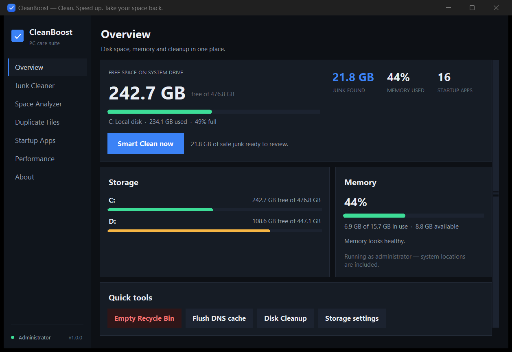
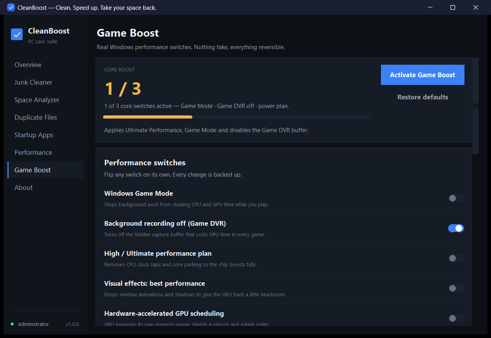
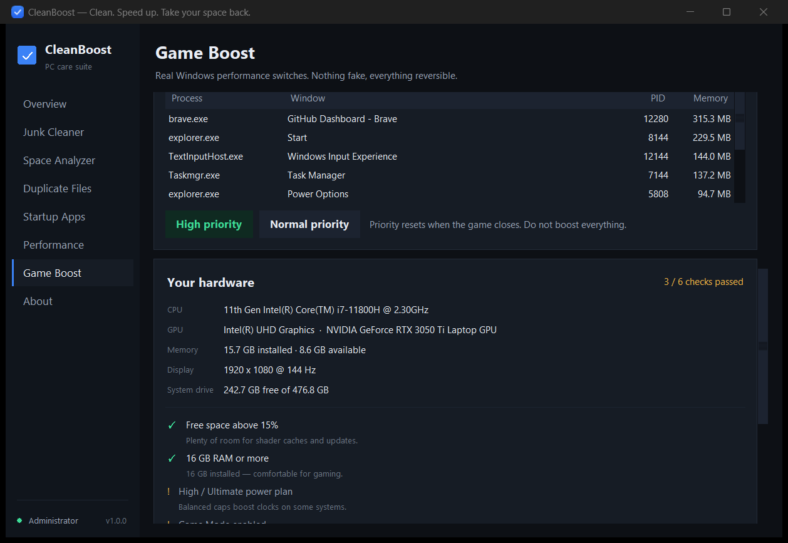

# CleanBoost

A small, honest Windows cleaner. It scans known junk locations, shows you the
numbers first, and only deletes what you approve.

No installer. No background service. No telemetry. No Electron. The whole app is
Python + Tkinter, so it idles around **30–45 MB of RAM** and starts in under a
second.



## Run it

**Easiest:** double-click `run.bat`.

**Desktop icon:** double-click `Create Desktop Icon.bat` once. It creates
`CleanBoost.lnk` on your Desktop with the app icon, pointing at this folder.

**From a terminal:**

```bat
python main.py
```

Requirements: Windows 10 or 11, Python 3.10+ (Tkinter is included with the
official Python installer).

**Optional:** run as administrator (button on the About screen) to unlock
Windows system folders such as `C:\Windows\Temp`, update caches and
`C:\Windows.old`. Everything else works in standard mode.

## What it does

### Overview
One glance at free disk space, memory pressure and startup load. **Smart Clean**
scans the safe default categories and asks for confirmation before removing
anything.

### Junk Cleaner
Each category shows its real size before you touch it.

| Category | What is removed |
| --- | --- |
| Temporary files | `%TEMP%`, `%LOCALAPPDATA%\Temp` files older than 12 h |
| Browser caches | Chrome / Edge / Brave / Vivaldi / Opera / Firefox caches |
| Thumbnail & icon cache | Explorer preview databases (Windows rebuilds them) |
| GPU shader caches | DirectX, NVIDIA and AMD compiled shaders |
| Crash dumps | `%LOCALAPPDATA%\CrashDumps` |
| Error reporting queues | Windows Error Reporting archives |
| Old installers | Setup files in Downloads older than 30 days (review) |
| Windows temp | `C:\Windows\Temp` (admin) |
| Recycle Bin | Emptied through the Windows shell API |
| Delivery Optimization | Windows Update peer cache (admin) |
| Prefetch | Boot traces, rebuilt automatically (admin) |
| Windows Update cache | Already-installed update packages (admin) |
| Windows logs | CBS / DISM / WindowsUpdate logs (admin) |
| Setup & upgrade logs | `C:\Windows\Panther` (admin) |
| System memory dumps | Minidumps and LiveKernelReports (admin) |
| Previous Windows install | `C:\Windows.old` (admin, review) |
| Upgrade leftovers | `$WINDOWS.~BT`, `$WINDOWS.~WS`, `$GetCurrent` (admin) |
| Leftover app data | AppData folders with no matching installed app (review) |

### Space Analyzer
- Live free/used meters for every fixed drive.
- **Large files** above 100 MB / 250 MB / 500 MB / 1 GB, biggest first.
- **Folder sizes** for your user profile, so you can see where the space went.

### Duplicate Files
Finds byte-identical files using a three-stage check: same size → same first
64 KB hash → full BLAKE2b hash. Same name is never enough. Extras can be
recycled with one click while the oldest copy is kept.

### Startup Apps
Lists registry `Run` entries and Startup-folder shortcuts, and lets you disable
them. **Disabling is reversible**: the entry is backed up to
`%LOCALAPPDATA%\CleanBoost\startup_backup.json` and can be re-enabled from the
same screen.

### Performance
- Live memory usage and the top 16 memory-hungry processes.
- End a task, flush the DNS cache, empty the Recycle Bin.
- Disable hibernation to delete `hiberfil.sys` (often 4–16 GB).
- Switch between High performance and Balanced power plans.
- Honest advice instead of fake "optimizer" magic.

### Game Boost


Built for gaming: real Windows switches that give the CPU and GPU more headroom,
plus a hardware readiness check and a one-click boost.

| Switch | What it changes |
| --- | --- |
| Windows Game Mode | Stops background work from taking CPU/GPU time while you play |
| Background recording (Game DVR) | Disables the hidden capture buffer that costs GPU time in every game |
| High / Ultimate performance plan | Removes CPU clock caps and core parking; creates Ultimate Performance if Windows hid it |
| Visual effects: best performance | Drops window animations and shadows |
| Hardware-accelerated GPU scheduling (HAGS) | GPU manages its own memory queue (needs a reboot) |

- **Activate Game Boost** applies the power plan, Game Mode and Game DVR in one go.
- **Restore defaults** puts every value back exactly as it was, including the power
  plan that was active before the first boost.
- **Boost a running game** raises a single process to High priority (and back to
  Normal). Anti-cheat protected games may refuse — that is normal and safe.
- The readiness panel checks free space, RAM, power plan, Game Mode, DVR and HAGS,
  and shows your real CPU, GPU, RAM, resolution and refresh rate.



All registry values are backed up to
`%LOCALAPPDATA%\CleanBoost\gaming_backup.json` before they are written. Nothing
here is a fake "RAM cleaner" — no memory is trimmed, no services are disabled,
and no game files are touched.

## Safety model

This is the important part.

1. **Allow-list only.** The scanner only walks explicitly declared roots. Your
   Documents, Pictures, Desktop, Music, Videos and program folders are never
   scanned for junk.
2. **Re-checked before every delete.** `core/cleaner.py` blocks anything inside
   `System32`, `SysWOW64`, `WinSxS`, `Program Files`, `Users\Public`,
   `System Volume Information`, and any drive root — even if a rule is
   misconfigured.
3. **Locked files are skipped, not forced.** No file unlocking, no service
   stopping, no registry surgery.
4. **Personal files go to the Recycle Bin.** Large files and duplicates use the
   Windows shell's undo-capable delete.
5. **Everything is logged.** Every cleanup writes freed bytes, item counts and
   duration to `%LOCALAPPDATA%\CleanBoost\history.json`.
6. **Every Game Boost change is reversible.** Registry values are backed up
   before the first write, and the previous power plan is remembered and
   restored. No services, drivers or scheduled tasks are modified.

Things CleanBoost deliberately does **not** do: registry *cleaning*, "RAM
boosters", disabling services, editing scheduled tasks, or touching Windows
components. Game Boost does change a handful of documented settings, and every
one of them is backed up and reversible.

## Project layout

```
CleanBoost/
├─ main.py               entry point
├─ run.bat               double-click launcher
├─ build_exe.bat         one-file .exe build (PyInstaller)
├─ core/
│  ├─ scanner.py         allow-list targets + scanning
│  ├─ cleaner.py         protected-path checks + deletion
│  ├─ dupes.py           duplicate detection
│  ├─ startup.py         reversible startup management
│  ├─ gaming.py          Game Boost: power plans, registry tweaks, priority
│  ├─ system.py          drives, memory, processes (ctypes)
│  └─ utils.py           sizes, elevation, Recycle Bin API
├─ ui/
│  ├─ app.py             window shell, router, background tasks
│  ├─ theme.py           palette and ttk styles
│  ├─ widgets.py         cards, meters, tables, checkboxes
│  ├─ dialogs.py         dark modal dialogs
│  └─ pages/             one file per screen
├─ tools/
│  ├─ selftest.py        engine tests (scan, delete, protection, dupes)
│  ├─ uismoke.py         opens every screen and exits
│  ├─ make_icon.py       generates assets/icon.ico
│  └─ shot.ps1           window screenshot helper
└─ assets/icon.ico
```

## Development

```bat
python tools\selftest.py     :: engine + safety checks
python tools\uismoke.py      :: opens every page once
python tools\make_icon.py    :: regenerate the icon
```

Build a standalone executable:

```bat
build_exe.bat
```

## Notes

- Windows may keep a few files locked while apps are running; those are counted
  as skipped rather than forced.
- "Leftover app data" is a heuristic. It is off by default and always shown as
  **Review**.
- Deleting `C:\Windows.old` removes your ability to roll back a Windows upgrade.

MIT-style use at your own risk: the app only deletes inside the allow-listed
locations described above, and every action is confirmed first.
